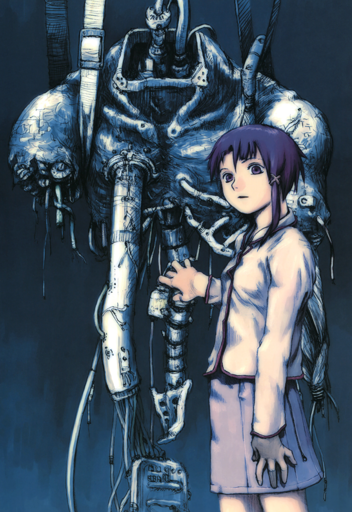

  

# Ocarina of Lain

A native PC recompilation of Ocarina of Time for Switch 2, with fixes for AMD graphics cards.

**Built on the port by chrg6, who gets all the credit for it.** This repo is chrg6's source plus the changes listed below, and it is not chrg6's official release. Please bring problems with this build here, not to chrg6. chrg6's `LICENSE` and `LICENSE-ADDITIONS` files apply and are unchanged.

chrg6 gave permission for this repo: *"You have full permissions to provide the code under your own GitHub repo, but you must name it something else. Reference work taken from me."*

No game files are in this repo. You need your own copy of the game.

## What we changed

| Fix | What you see | Where |
|---|---|---|
| Image fetches clamped to the image | The pale stepped box near the screen edges is gone, and the fog stays | `spirv_fetch_clamp` in `runtime/gfx_shader.c` |
| Float bits kept on mesh and task shaders | Leaf shadows no longer cover the whole shadow map: large GPU saving in wide outdoor views | `spirv_float_bits` in `runtime/gfx_shader.c` |
| Frame wait after the first submission | Flashes in Kokiri gone. Set `submit_finish = 0x1` in `nx2navi.ini` | your `nx2navi.ini` |
| AVX2 game code | Faster CPU side (optional, see step 4) | `tools/lain/build_guest.py` |
| New name and icon | Window title, settings menu, icon | `runtime/gfx_window_win.c`, `runtime/ui/menu.cpp`, `runtime/ocarina-of-lain.ico` |

The box's cause: the ground fog shader projects a point to the screen and reads depth there. Near the left, right and top edges that point is off screen, which Vulkan leaves undefined, and on an RX 9070 those pixels took a different lighting path. The full investigation is in [docs/lain-findings.md](docs/lain-findings.md).

## Results

Tested on one PC only: Radeon RX 9070, driver 26.10.1, at 2560x1440.

| Scene | Original 0.5.0 | Ocarina of Lain |
|---|---|---|
| Kokiri Forest, heavy wide view | frame about 39 ms, GPU 24 ms | frame about 22 ms, GPU about 12 ms |
| Saria scene | not measured | frame about 15 to 18 ms, GPU about 10 ms |

Measured with FSR 3 frame generation on, so each frame above is a real frame and twice as many reach the screen. This build is merged with upstream a3246088: its Kokiri numbers are higher than our earlier 18 ms and 8 ms, which came from a build before the merge, under different settings.

The flash meter found no spikes over 4,200 frames of the Deku Tree cutscene at the settings above. It reads real frames only.

## Known problems

- Upstream's queue ordering (`NX2NAVI_EVENT_ORDER`) is off by default here. On our AMD test PC it made the lighting jump in the Deku Tree cutscene and brought flashes back. With it off, brightness jumps over that cutscene match the build before the merge. Upstream added it because Link and other characters drew too dark, so they may draw darker here. Set `NX2NAVI_EVENT_ORDER=1` to turn it on.
- Mild lighting pops may remain in the Deku Tree cutscene: seen by eye once with this build at high frame rates, not found by the meter in the part it covered.
- Falling leaves may still draw black. Not measured on this build.
- 180 fps on screen needs 11.1 ms a real frame. This build does not reach that in the scenes above.
- A test run dropped to about 0.1 GB of free system commit. Machines with less memory or page file may have trouble.
- Upstream's translator patch for tree flicker (0036) is in the source, but this build runs the older translator.
- Not checked: a 10-minute run.
- Only tested on the PC above. Other cards may behave differently.

## Build it

You need Windows, about 60 GB free, and your own game. The scripts relink the runtime against that working install, so the install does the heavy work.

1. Install chrg6's original port, version 0.5.0, with its launcher, and let it build the game from your own files. Run it once.
2. Install Python 3.12 or newer. Clone this repo into a folder named `src` (for example `C:\Users\you\Games\nx2navi-src\src`).
3. Copy `tools/lain/build_rt.py` and `tools/lain/build_guest.py` up one level, next to `src`. Edit the paths at the top of both to match your PC: `ROOT`, `GAME`, `CACHE`, `MSYS`. They currently hold the paths from the PC this was built on.
4. Optional, faster on CPUs with AVX2: `python build_guest.py`. It writes `guest-x86-64-v3-O1`, and step 5 links it with `--guest`.
5. Build: `python build_rt.py --setup --guest guest-x86-64-v3-O1 --out exe-ms.exe`. Leave out `--guest ...` if you skipped step 4. The result is `out\exe-ms.exe`.
6. Install: in the install's `game` folder, back up `ocarina.exe`, then copy `exe-ms.exe` over it, keeping the name `ocarina.exe` so the launcher still starts it.
7. In `nx2navi.ini`, under `[performance]`, set `submit_finish = 0x1`.

A launcher update overwrites the exe: repeat step 6 afterwards.

## Switches

Set as environment variables. These internal names still use the original project's prefix:

- `NX2NAVI_FETCH_CLAMP=0` turns the box fix off.
- `NX2NAVI_FLOAT_BITS` is a mask: 1 mesh and task (default), 2 vertex, 4 fragment, 8 compute. All stages at once gave a burst of noise in an older test.
- `NX2NAVI_MESH_INVARIANT=1` marks mesh positions invariant. Off by default, not tested yet.

## Test tools

`tools/lain/` holds the scripts used to test: `rgp_run.ps1` (one run), `ab.ps1` (alternating timing runs), `metrics.py`, `flash3.py` (flash meter), and the shader debug helpers. They hold paths from the build PC, so edit them first. They contain no game data.
